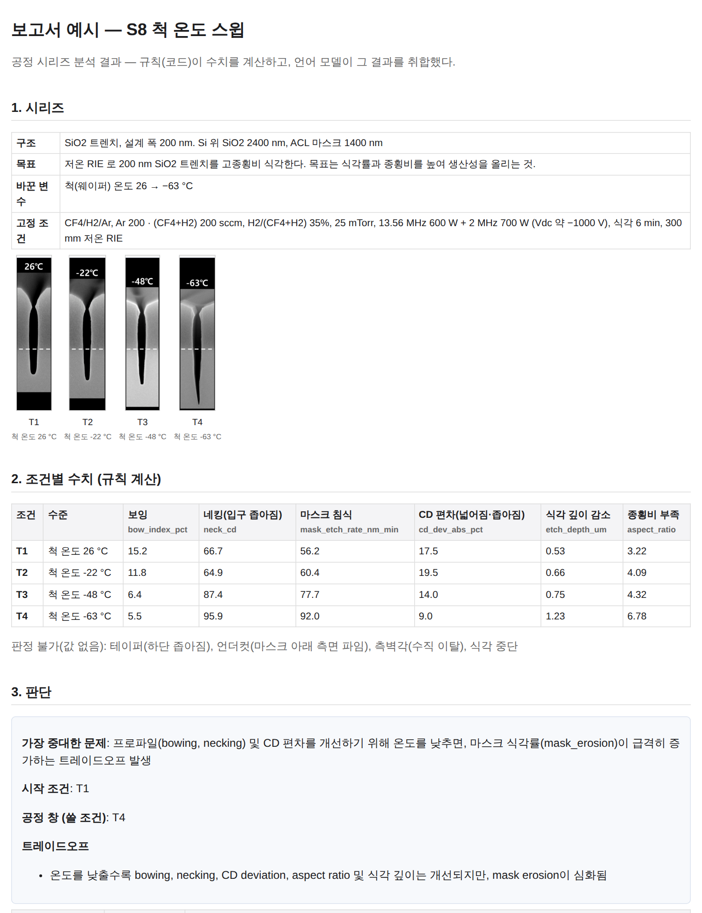
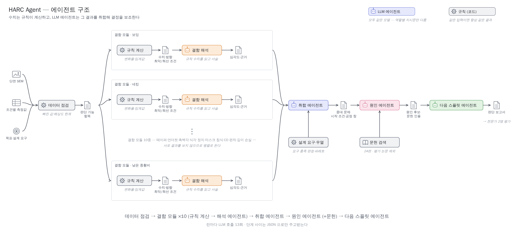
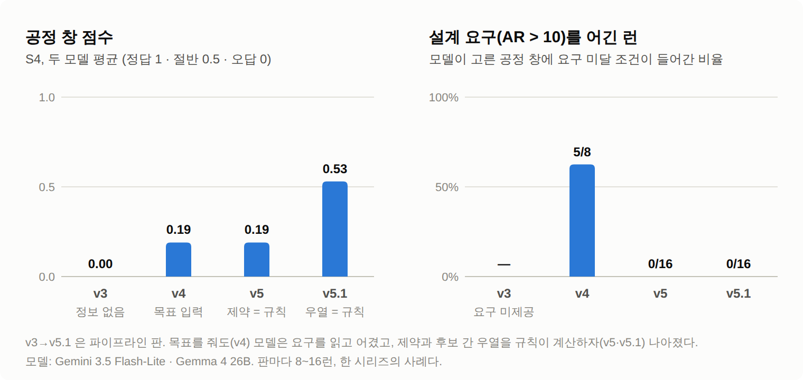

# HARC Agent — 단면 SEM 기반 식각 공정 판단 보조 시스템 (연구 진행 중)

**김성민** · 서울대학교 산업공학과 · kimandie@snu.ac.kr

[](https://github.com/kimandie-sudo/harc-agent/actions/workflows/tests.yml)

> **반도체 개발 단계에서 엔지니어가 단면 SEM 을 보고 판단하는 시간을, 규칙과 LLM 이 역할을 나눠 줄여 주는 시스템.**
>
> *A research prototype that helps process engineers interpret cross-sectional SEM results of high-aspect-ratio etch
> DOE splits. Deterministic rules compute every number; LLM agents aggregate the results and support the decision.
> Evaluated against the authors' own conclusions in 8 published DOE series. So far, literature retrieval (RAG) did not
> improve decisions, while moving constraint checks and Pareto dominance from the LLM into rules raised the
> process-window score on one series from 0.19 to 0.53. Work in progress — rubrics are drafts pending expert review.*

## 한눈에 보기 — 시스템이 내놓는 보고서

[](docs/예시_보고서_S8.html)

실제 논문(Kwon et al. 2024, CC BY)의 온도 스윕 데이터에 대해 시스템이 만든 보고서다 — 단면 SEM, 규칙이 계산한 결함 지표,
가장 중대한 문제·공정 창·트레이드오프, 원인 후보, 다음 스플릿 제안. 전체는 [`docs/예시_보고서_S8.html`](docs/예시_보고서_S8.html)
(내려받아 브라우저로 열기). 전문가 평가에 쓰는 보고서와 같은 형식이다.

## 문제

개발 단계(TD)의 DOE 스플릿에는 양산과 달리 **라벨 이력도 기준선도 없다**. 엔지니어가 단면 사진에서 CD 를 재고,
결함(보잉·네킹·테이퍼…)을 판정하고, 원인을 추정해 다음 스플릿을 정한다. 병목은 장비가 아니라 그 판단 시간이다.

## 구조 — 수치는 규칙이, 판단 보조는 LLM 이



| 단계 | 규칙 (코드) | LLM 에이전트 | 코드 |
|---|---|---|---|
| 1. 데이터 점검 | 값이 채워졌는지, 해상도로 어디까지 판별되는지 | (이미지 입력 시) 이미지 품질 | `harc/checker.py` |
| 2. 결함별 (10종) | 보잉·네킹·테이퍼·마스크 침식·CD 편차·낮은 종횡비 … 의 수치·방향·최악 조건 | 결함마다 하나씩, 규칙 결과를 해석 | `harc/defects/` |
| 3. 취합 | 설계 요구(예: AR > 10) 충족 판정, 후보 간 지배 관계 | 가장 중대한 문제·시작 조건·공정 창(쓸 조건) | `harc/pipeline.py`, `harc/constraints.py` |
| 4. 원인 추정 | 문헌 검색(RAG) — 평가 대상 논문은 제외 | 원인 후보를 세우고 관측 추세로 지지·배제 | `harc/pipeline.py`, `harc/rag.py` |
| 5. 다음 스플릿 | — | 다음 DOE 의 변수·방향·수준 | `harc/pipeline.py` |

LLM 칸은 모두 **같은 모델 하나**를 역할별 지시문으로 부른다 — 런마다 13회, 단계 사이는 JSON 으로만 주고받는다.
비교 기준선(`--mode single`)은 같은 규칙 결과를 받아 LLM 한 번에 3~5단계를 답한다.

## 평가

- **정답**: 원 논문 저자의 결론. **단위**: 논문 1편 = DOE 시리즈 1개 — 실제 논문 8편 (`data/series/`, `answers/`)
- **자동 채점**: 조건 집합 채점기(`harc/judge.py`), 인용 적합성(`harc/cite_eval.py`)
- **주 지표(예정)**: 전문가 2명이 눈가림 보고서를 평가 (보고서 생성 `tools/expert_report.py`)
- 회귀 테스트 280여 개 — API 키 없이 돈다 (`python -m pytest tests`)

## 지금까지의 결과

**기준 성능** (v4 기준선 64런 = 8편 × 2모델 × 모드 2 × 문헌 유무 2, 자동 채점)

| 항목 | 점수 | 오답 |
|---|---:|---:|
| 가장 중대한 문제 | **0.96** | 0 / 56 |
| 시작 조건 | 0.71 | 4 / 48 |
| 공정 창 (쓸 조건) | **0.62** | 17 / 64 |

문제를 *찾는* 것은 잘하고, 조건을 *고르는* 것이 약했다. 정답은 저자 결론이고, 점수는 정답 1 · 허용 0.5 · 오답 0 의
평균이다(루브릭 밖의 답은 제외). 아래 1 은 그 약점을 고친 과정이다.

1. **LLM 은 설계 요구를 읽고도 어긴다 → 산수는 규칙으로 옮겼다.** 한 시리즈(S4)에서 목표를 줬더니 8런 중 5런이
   "AR > 10 을 못 맞춘다" 고 적고도 그 조건을 골랐다. 요구 판정과 후보 간 지배 관계를 규칙으로 옮기자 공정 창 점수가
   0.19 → 0.53, 요구 위반 5/8 → 0/16 (`outputs_v4base`·`outputs_v5s4`·`outputs_v51s4`)

   

2. **문헌 검색(RAG)은 판단 정확도를 올리지 않았다.** 9개 배치에 걸쳐 이득이 없었다 — 첫 5개
   배치의 80쌍에서 5승 57무 18패(배치 단위 보수적 검정 p = 0.25), 검색기를 바꾼 뒤 4개 배치에서도 마찬가지였다.
   검색 자체는 정상이었다(인용 환각 1/210). 기제 실험(400런, `outputs_mech`)에서는 **무관한 글도 답을 움직였다**(답이 바뀐 비율: 실제 문헌 64%, 길이를 맞춘 무관 문서 39%, 반복 잡음 15%)
3. **출력 형식이 채점 가능성을 정한다.** 공정 창을 비워 둘 수 있게 하자(v2) multi 모드 런의 76%(276런 중
   210런)가 비었다. 반드시 지목하게 하자(v3) 모두 채워졌고, 가장 중대한 문제·시작 조건·공정 창 가운데 자동 채점이
   못 읽는 답이 35% → 9~16% 로 줄었다

## 한계

- 루브릭 8편은 **전문가 검토 전 초안**이다 (`answers/*.json` 의 `rubric_author`). 공정 창 점수의 상당 부분이 허용·오답 경계에 기댄다
- 지금까지 돌린 모델은 Google 의 소형 모델 두 개(Gemini Flash-Lite, Gemma 26B — 무료 티어)다. 다른 회사 모델과는 아직 비교하지 않았다
- 시리즈 8편, 셀당 1~2런. S4 사례(v5·v5.1)는 한 시리즈의 결과다 — 8편 전체의 v5.1 기준선은 아직 없다
- 자동 채점은 판단(가장 중대한 문제·시작 조건·공정 창)만 변별한다. 원인 후보와 다음 스플릿 제안의 품질은 전문가 평가로 잴 예정이다
- 이 시스템의 목적인 **판단 시간 단축은 아직 재지 않았다** — 전문가 평가에서 탐색 지표로 기록한다

## 저장소 안내

| 경로 | 내용 |
|---|---|
| `harc/` | 파이프라인·결함 모듈·채점기·검색 |
| `data/series/`, `answers/` | 시리즈 입력과 정답 루브릭 (정답은 모델 입력과 분리) |
| `outputs*/` | 모든 런의 결과 JSON (공개본은 검색 청크 원문을 지우고 id 만 남겼다) |
| `tools/` | 실험 실행·분석, 보고서 생성 |
| `docs/` | 구조도, S4 사례 그림, 예시 보고서 |

```bash
pip install -r requirements.txt
python -m pytest tests                         # 키 불필요
python run.py --series S1 --provider mock      # 구조 점검
python -m harc.judge outputs_v4base            # 저장된 런 채점
```

문헌 코퍼스(PDF)는 저작권 때문에 싣지 않았다 — `corpus/README.md` 참고. 일부 시리즈(S2·S5)의 SEM 사진도 원 논문 라이선스
(CC BY-NC-ND) 때문에 뺐다.

## 라이선스

- **코드**(`harc/`, `tools/`, `tests/`, `run.py`): MIT — `LICENSE`
- **시리즈 데이터의 수치**는 각 원 논문에서 옮긴 것이다(출처 DOI 는 `answers/*.json` 의 `source`). SEM 크롭은 CC BY 논문에서만
  실었다 — 출처·라이선스·변형 여부는 [`data/images/CREDITS.md`](data/images/CREDITS.md). 루브릭·문서는 저자가 쓴 것이다
- 원 논문을 인용할 때는 각 DOI 를 따른다

## 개발 방식

설계·실험 판단은 연구자가 하고, 구현·분석의 상당 부분은 AI 코딩 도구(Claude Code)와 함께 했다. 커밋 기록에 그대로 남아 있다.
